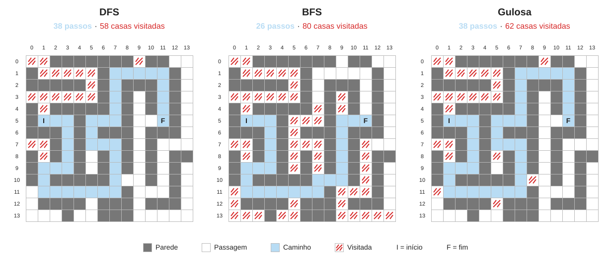

# Labirinto 14x14: DFS, BFS e Busca Gulosa

Atividade da aula 9 de Algoritmos e Estruturas de Dados II. O programa monta um labirinto, transforma em grafo e procura a saída com três buscas: DFS, BFS e gulosa. Cada uma devolve o caminho e o número de casas visitadas.

## Como rodar

```
no terminal, execute 'python labirinto.py'
```

O programa desenha o caminho de cada busca no terminal e mostra a tabela comparativa no final.

## O labirinto

```
..#######.##..
#.....#.....#.
#####.#.###.#.
......#.#.#.#.
#.#####.#.#.#.
#I..#...#..F#.
###.#.###.###.
..#.#...#.#...
#.#.#.#.#.#.##
#...#.#.#.#.#.
#.#####...#.#.
........#...#.
.####.###.###.
...#..###.....
```

`I` é o início, `F` é a saída, `#` é parede e `.` é casa livre. As coordenadas são (linha, coluna), começando em zero: início em (5, 1) e saída em (5, 11).

Existem duas rotas até a saída. As duas passam por (10, 7). Dali, a rota curta segue para a direita, por (10, 8), e termina com 26 passos. A rota longa sobe por (9, 7), contorna o mapa pela linha 1 e termina com 38 passos. O mapa tem 105 casas livres e 10 becos sem saída.

Cada casa livre é um vértice, e duas casas livres vizinhas (cima, direita, baixo, esquerda) são ligadas por uma aresta. O grafo é um dicionário de listas.

- **DFS:** recursiva, segue a ordem de `DIRECOES` (cima, direita, baixo, esquerda) e vai o mais fundo possível antes de voltar.
- **BFS:** usa uma fila e anda por camadas de distância a partir do início.
- **Gulosa:** usa uma fila de prioridade (`heapq`) e sempre expande a casa de menor `h`, a distância de Manhattan até a saída. Em caso de empate, vale a menor tupla `(linha, coluna)`.

As três guardam em `anterior` de qual casa cada casa foi descoberta. É isso que permite remontar o caminho no final.

Casas visitadas são as casas descobertas pela busca, contando `I` e `F`. Na BFS e na gulosa, a casa é marcada quando entra na fila. Na DFS, quando a recursão entra nela. Passos são os movimentos do caminho, ou seja, o número de casas do caminho menos um.

## Resultados

| Algoritmo | Passos | Casas visitadas |
|---|---:|---:|
| DFS | 38 | 58 |
| BFS | 26 | 80 |
| Gulosa | 38 | 62 |



Em azul está o caminho encontrado. Os arranhados vermelhos são casas visitadas que ficaram fora do caminho. As casas do caminho também foram visitadas, então: DFS 39 + 19 = 58, BFS 27 + 53 = 80 e gulosa 39 + 23 = 62.

A BFS foi a única a achar a rota curta, mas foi a que mais casas visitou. A gulosa visitou menos casas que a BFS e, mesmo assim, ficou com a rota longa. Visitar menos casas não quer dizer encontrar o menor caminho.

## Análise de resultados, junto aos questionamentos dos slides da última aula

### Por que a BFS encontrou o menor caminho e a DFS não?

A BFS visita todas as casas a 1 passo do início, depois as a 2 passos, e assim por diante. Como todo movimento custa um passo, a primeira vez que ela descobre uma casa é pelo menor número de passos. A saída está a 26 passos, então ela é descoberta na camada 26. A casa (1, 7), por onde a rota longa passa, só aparece na camada 30, e a BFS já terminou antes.

A DFS não compara tamanhos. Ela segue a ordem cima, direita, baixo, esquerda e para na primeira vez que chega na saída. Em (10, 7), a casa de cima (9, 7) vem antes da da direita (10, 8), então ela entra na rota longa e nunca chega a tentar (10, 8). Ela achou um caminho, mas nada garante que seja o menor.

### Em que ponto do labirinto a gulosa foi induzida a um caminho inadequado por uma parede?

Em (5, 7). A casa tem `h = 4`, a menor de todas até então, porque está na mesma linha da saída. Mas a parede em (5, 8) fica entre ela e `F`. A heurística só mede a distância em linha reta e não sabe das paredes. Para contornar, a gulosa sobe pela coluna 7 e o `h` volta a crescer (5, 6, 7, 8), até chegar na linha 1 e seguir para a direita.

A rota curta, que começa em (10, 8), ficou esperando na fronteira com `h = 8` e nunca foi expandida. Quando a gulosa chegou em (1, 7), também com `h = 8`, a casa (1, 7) saiu primeiro pelo desempate, e dali o `h` voltou a cair até a saída.

### Como o caminho é reconstruído a partir das casas visitadas?

Sempre que uma casa é descoberta, guardo em `anterior` de onde ela veio: `anterior[vizinho] = atual`. Quando a busca chega em `F`, a função `reconstruir` parte de `F` e vai seguindo `anterior` de casa em casa, até chegar em `I`, cujo anterior é `None`. Depois inverte a lista para ficar de `I` até `F`.

Por exemplo, na gulosa: `anterior[(5, 11)]` é (4, 11), `anterior[(4, 11)]` é (3, 11), e assim por diante até (5, 1). Só entram no caminho as casas dessa corrente. Os becos e as outras casas visitadas ficam de fora.
